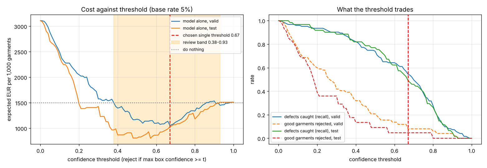

# Assignment 2 Report

- **Name**: Aitana Damotte Huedo
- **Student ID**: 18564
- **Email**: adamotte.ieu2022@student.ie.edu
- **Group**: BBADBA 5B 

How to reproduce: `uv run python main.py train` runs the whole pipeline (download, describe, finetune,
evaluate, cost, sensitivity). `uv run python main.py app` opens the dashboard. Every assumption is in
[config.yaml](config.yaml). All numbers below come from [results/](results/), and all figures are in
[results/plots/](results/plots/).

## Business problem, and the cost of being wrong

**The decision.** I work in a clothing factory. At the end of the sewing line, every garment is
photographed before it is packed. For each photo, the model decides one of three things:

- **Pass**: pack and ship the garment.
- **Review**: a QC inspector looks at the spot the model boxed and decides.
- **Reject**: the garment goes to the rework station.

**Who acts on it.** QC inspectors handle the review lane. The rework station handles rejects. The QC
manager owns the thresholds and the staffing.

**The positive class** is "garment has a defect". I decide at image level. A garment counts as
defective if *any* defect box scores at or above the threshold. Its score is the highest box
confidence in the photo. I care whether the garment ships, not which defect it has. The class only
helps the reviewer know what to look for.

**What each mistake costs** (per garment, in euros; all in `config.yaml`):

| Outcome | Cost | Where the number comes from |
|---|---|---|
| False negative: defect shipped | **€30** | Return shipping and handling (~€8), refund and customer service (~€4), garment written off at factory cost (~€12), bad review and buyer chargeback (~€6). |
| False positive: good garment rejected | **€3** | A re-inspection at the rework station (~3 min at €16/h, ~€0.80), handling and queueing (~€0.70), and some needless rework (~20% × €7). |
| True positive: defect caught | **€5** | Average repair (re-sew, spot clean) or downgrade to "seconds". |
| True negative: good garment shipped | €0 | Nothing extra happens. |
| Model running cost | €0.01 | Camera station and compute, ~€25k spread over 3 years of production. |

**Why a missed defect is worse.** A missed defect reaches the customer. Then I pay for the return,
the refund, the lost garment and the damage to the brand. A false reject stays inside the factory.
Someone looks at the garment again and sends it on. Catching a defect saves me €30 − €5 = €25. A
false alarm costs me €3. So a miss is **about 8 to 10 times worse** than a false alarm.

This drives everything after it:

- **Which metric I care about.** Recall on defects matters more than precision.
- **Where the threshold sits.** In theory I should flag a garment once P(defect) > 3 / (3 + 25) ≈ 11%.
- **The base rate pulls the other way.** Only ~5% of garments are defective. So false alarms on the
  other 95% add up fast.
- **Why the review lane exists.** I want a cheap check on the uncertain cases.

## Dataset

**What I used:** Roboflow Universe, workspace **`sqc`**, project **`fabric-defect-detection-ehhyx`**,
version **2**. Link: <https://universe.roboflow.com/sqc/fabric-defect-detection-ehhyx/dataset/2>.
License CC BY 4.0. I used it as is and did not fork it.

**What one image is:** one 640×640 photo of a piece of fabric or a garment surface, with at least one
labelled defect. There are five classes:

- **gray stitch**: a wrong or visible stitching line;
- **hole**;
- **selvet**: a selvage (edge band) fault;
- **stain**;
- **tear**.

**Why it serves the problem.** These are the defects an end-of-line inspector looks for on a
garment. The photos are close-ups of real fabric with folds, prints and uneven light, which is close
to what a camera at an inspection table would see.

**Two datasets I tried first and rejected:**

1. **`hammy/fabric-defect-lcird-1ifel` v1** (the one I first chose) is broken.
   - 2,490 of its 2,491 label files are empty. The whole dataset holds **one** box (a "stain").
   - It has no hole, line or knot examples.
   - It has no valid or test split.
2. **`yolov7-vdg8u/fabric-defect-detection-jdyz3` v3** looks better on paper: 157 test images and
   all four classes in test. But its **test split is leaked**.
   - I compared each test image with every train image (mean grey-level difference at 64×64).
   - **All 157 test images and all 500 valid images have an identical copy in train.** The
     difference is 0.2 out of 255, which is just JPEG re-saving. Unrelated pairs differ by about 34.
   - A test score there would measure memory, not how the model does on new garments.

The same check on sqc v2 finds only 2 of 61 test images and 2 of 123 valid images with a copy in
train. So sqc v2 is the only one of the three I can trust.

## What the dataset's composition implies

I computed this from the label files ([results/dataset_stats.json](results/dataset_stats.json),
[results/plots/dataset.png](results/plots/dataset.png)).

| Split | Images | Unique source names | Boxes | Defect-free images | gray stitch | hole | selvet | stain | tear |
|---|---|---|---|---|---|---|---|---|---|
| train | 1,266 | 353 | 2,131 | **0** | 357 | 243 | 536 | 581 | 414 |
| valid | 123 | 115 | 177 | **0** | 19 | 44 | 30 | 49 | 35 |
| test | 61 | 57 | 103 | **0** | 27 | **3** | 27 | 28 | 18 |

Object size, as the median box area in % of the image (train / test):

| Class | Train | Test | Notes |
|---|---|---|---|
| gray stitch | 15.8% | 13.1% | |
| hole | 1.5% | 1.6% | the 10th percentile is only 0.16% of the image |
| selvet | 8.9% | 2.5% | |
| stain | 3.1% | 3.4% | |
| tear | 2.3% | 2.8% | |

Holes are tiny. Gray stitch and selvet boxes are long bands that cover a big part of the image.

What this means:

1. **Hole has only 3 test boxes, in 3 images.** Any hole number on test (AP50 0.665, recall 0.67) is
   an anecdote. I use the valid split (44 holes) to judge holes instead.
2. **The test split is small.** It has 61 images and 18 to 28 boxes per class. One image more or less
   moves a per-class recall by 4 to 6 points. My image-level recall at the chosen threshold is 49%,
   with a 95% interval of **37% to 61%**.
3. **No defect-free images in any split.** Every photo has a defect, but in a real factory ~95% of
   garments are fine.
   - The test set alone cannot measure false positives at the garment level. A model that rejects
     everything scores 100% accuracy on it.
   - To measure false alarms, I cut **defect-free windows** (256×256 px, touching no labelled box)
     out of the valid and test photos: 301 valid crops and 131 test crops.
   - A crop is 1/6.25 of a photo. So I estimate the chance that a good garment's photo is flagged as
     1 − (1 − crop rate)^6.25.
   - This is my weakest assumption, and I test it in the sensitivity analysis.
4. **The train split is augmented three times.** Its 1,266 images are about 422 source photos, each
   saved three times with a small rotation and salt-and-pepper noise. So there is much less variety
   than 1,266 suggests. It also means one epoch is really three passes over each photo.
5. **The test split is not quite production.** These are hand-held photos of loose fabric, with folds,
   shadows and many prints. A factory camera would have fixed light and a flat garment, so production
   could be easier. But the defects would be on whole garments, at a different scale.
6. **Images were stretched to 640×640** by Roboflow, so shapes are slightly distorted. I fed them in
   the same way at inference.

What I therefore cannot conclude:

- I cannot give a reliable hole number.
- I cannot claim the false-alarm rate is exact; it rests on crops, not real good garments.
- I cannot claim the costs hold to the euro; the ranges I trust are the bootstrap intervals below.

## Finetuning and baselines

**Model:** I finetuned **yolo11n** for object detection, starting from the COCO checkpoint.

- **Why detection, not classification:** a box tells the reviewer where to look. That makes a review
  take seconds, not a full inspection.
- **Why the nano model:** it trains on a CPU in under 3 hours.
- **Why not yolo11s:** it would take about 3× longer (~9 h). With 61 test images, a small gain would
  sit inside the noise.

**Where and how I trained:**

| Setting | Value |
|---|---|
| Machine | Claude Code cloud session (Linux VM, 4-core Intel Xeon CPU, no GPU), torch 2.11 CPU, Ultralytics 8.4.173 |
| Run | `uv run python main.py train` |
| Epochs | **30** (patience 10; it did not stop early) |
| Image size / batch | **640** / **16** |
| Optimizer | Ultralytics "auto" → AdamW, lr 0.00111 |
| Seed | 0, deterministic |
| Augmentations | Ultralytics defaults (mosaic, flips, HSV) |
| Training time | **171 min** |
| Best epoch | 25 (valid mAP50 0.600, mAP50-95 0.314) |
| Weights | `weights/best.pt` |

I did not need Colab.

After training I moved the defect-free crops from 320 px to 256 px, to get more of them (131 instead
of 63 on test). Then I re-ran evaluation and costing with `uv run python train.py --skip-training`.
That flag reuses the same weights. Running `main.py train` with today's `config.yaml` reproduces
everything.

**Results on the same test split (61 photos):**

| Model | mAP50 | mAP50-95 | Class-agnostic AP50 | Threshold (picked on valid) | Defects caught (image) | Good garments rejected | € per 1,000 if it decides alone |
|---|---|---|---|---|---|---|---|
| **Finetuned yolo11n** | **0.633** | **0.339** | **0.595** | 0.67 | 49.2% | 4.7% | **€1,029** |
| COCO yolo11n, zero-shot | 0 | 0 | 0.034 | 0.80 | 1.6% | 4.7% | €1,623 |
| Trivial: predict nothing (always pass) | 0 | 0 | 0 | – | 0% | 0% | €1,500 |
| Trivial: majority class on this split (always reject) | – | – | – | – | 100% | 100% | €3,100 |

Notes on the table:

- **The finetuned model beats both baselines** on every detection metric and on cost.
- **The COCO model is near zero, as expected.** COCO has 80 everyday classes (person, car, banana…)
  and no fabric-defect class. So its class-aware mAP is 0 by construction.
  - To be fair to it, I also gave it credit for boxing *anything* where a defect is (class-agnostic
    AP50). It still scores only 0.034.
  - It drew 412 boxes on the 61 test photos, with labels like "bed", "airplane" and "banana". Folds
    and prints look like objects to it.
  - **It is worse than doing nothing** (€1,623 vs €1,500). It rejects good garments while catching
    almost no defects.
- **A finding: the majority-class baseline beats my model on test accuracy.** Every test photo is
  defective, so "always reject" scores 100% image accuracy, against 49% for my model.
  - This is why accuracy on this split means nothing for the business.
  - Once I weight by a realistic 5% base rate, "always reject" is the most expensive option of all
    (€3,100).
- **A second finding: the model alone loses to a person checking everything** (€1,029 vs €957). At
  the cost-optimal threshold it lets half the defects through. It only wins once people review its
  uncertain cases (next sections).

The gap to the COCO model is as large as I expected. The model's absolute level (mAP50 0.63) is
modest, which is what I expected from ~422 source photos and a nano model trained on a CPU.

## Per-class evaluation and failure modes

I used Ultralytics for P, R and AP. Its P and R are taken at the confidence that maximises F1
([results/plots/per_class.png](results/plots/per_class.png)).

| Class | Test boxes | Test P | Test R | Test AP50 | Test AP50-95 | Valid AP50 | Valid AP50-95 |
|---|---|---|---|---|---|---|---|
| gray stitch | 27 | 0.67 | 0.48 | 0.602 | 0.375 | **0.754** | **0.497** |
| hole | **3** | 0.89 | 0.67 | 0.665 | **0.482** | 0.568 | 0.306 |
| selvet | 27 | 0.81 | 0.47 | 0.562 | **0.196** | 0.493 | 0.205 |
| stain | 28 | 0.80 | 0.64 | **0.722** | 0.399 | **0.757** | 0.371 |
| tear | 18 | 0.66 | 0.54 | 0.616 | 0.242 | **0.423** | **0.192** |
| **All** | 103 | 0.77 | 0.56 | **0.633** | **0.339** | 0.599 | 0.314 |

At my operating threshold (box confidence ≥ 0.67, IoU ≥ 0.5, test):

| Class | Precision | Recall |
|---|---|---|
| gray stitch | 0.88 | 0.26 (7/27) |
| hole | 1.00 | 0.33 (1/3) |
| selvet | 0.83 | 0.19 (5/27) |
| stain | 0.87 | 0.46 (13/28) |
| tear | 1.00 | 0.28 (5/18) |

**Confusion matrix** (test, conf ≥ 0.67; rows = true class, columns = predicted;
[results/plots/confusion_test.png](results/plots/confusion_test.png)):

| true \ predicted | gray stitch | hole | selvet | stain | tear | background (missed) |
|---|---|---|---|---|---|---|
| gray stitch | **7** | 0 | 0 | 0 | 0 | 20 |
| hole | 0 | **1** | 0 | 0 | 0 | 2 |
| selvet | 0 | 0 | **5** | 0 | 0 | 22 |
| stain | 0 | 0 | 0 | **13** | 0 | 15 |
| tear | 0 | 0 | 0 | 0 | **5** | 13 |
| background (false box) | 1 | 0 | 1 | 2 | 0 | – |

**What carries the headline number.** **Stain** carries it. It has the best AP50 on both splits (0.72
test, 0.76 valid), and it is the class with the most training boxes (581). Gray stitch is strong on
valid (0.75) but weaker on test.

**Where the model fails, named:**

1. **It never confuses one defect with another.** Every off-diagonal cell between classes is 0. All
   its errors are *misses* (72 of 103 test boxes at 0.67) plus 4 false boxes on background.
   - For the business this is good news: a box, when it appears, is almost always a real defect.
   - The problem is that it stays silent too often.
2. **Selvet localisation is bad.** AP50-95 is 0.196 on test and 0.205 on valid. Selvet boxes are long
   bands, and the model finds the fault but not its exact extent. At 0.67 it finds 1 of 17 large
   selvet boxes.
3. **Tear is the weakest class on valid.** AP50 is 0.42, and precision 0.41 at the F1 point. Tears on
   printed fabric look like part of the print.
4. **Small stains are missed.** At 0.67 on test it finds 12 of 18 large stains (> 2% of the image),
   1 of 8 medium ones and 0 of 2 small ones. On valid: 17 of 23 large, 6 of 16 medium, 0 of 10 small.
5. **Holes.** On valid (44 holes) it finds 2 of 10 small holes and 6 of 15 large ones. Test has 3
   holes, so I do not judge holes on test.
6. **The six hardest test photos** ([results/plots/failures.png](results/plots/failures.png)) show
   the pattern. Their top scores range from 0.06 to 0.23:
   - a tear on a yellow floral print;
   - a faint tear on white fabric;
   - a faint stain on white fabric;
   - a selvet fault on a patterned sheet;
   - a gray stitch that looks like decorative top-stitching;
   - a 1 mm dark spot.

   **Low contrast and busy prints are where it breaks.**

## Cost matrix and operating point

**Base rate.** I assume **5%** of garments reach end-of-line inspection with a visible defect. Apparel
factories usually measure a 2–8% defect rate at final inspection (DHU), so 5% is a middle value.

**How I pick the threshold.**

1. For every threshold from 0 to 1 in steps of 0.01, I compute two rates:
   - recall: the share of defective photos flagged;
   - false-alarm rate: the share of good garments flagged, from the crops.
2. I turn each pair into an expected cost per garment:
   p·[recall·€5 + (1−recall)·€30] + (1−p)·[false-alarm·€3] + €0.01.
3. I pick the minimum **on the valid split**, then report it on test. This way the threshold is not
   tuned on the numbers I report.

- **Model alone:** valid minimum at **0.67** (€1,058 per 1,000). On test at 0.67:
  - recall **49%** (95% CI 37–61%);
  - 1 of 131 crops flagged (0.8%; CI 0.1–4.2%) → **4.7%** of good garments rejected;
  - **€1,029 per 1,000**.
- **The test curve's own minimum is 0.57** (€803). The valid curve is flat from 0.5 to 0.67 and the
  test curve drops before 0.67. So 0.67 is a little cautious. I keep it because choosing on test
  would be cheating.
- **Why the threshold is so high.** Every point of false alarms costs 950 × €3 / 100 = €28.5 per
  1,000. Every point of recall gains only 50 × €25 / 100 = €12.5 per 1,000. Because good garments are
  19 times more common, false alarms dominate the model-alone curve.

**Each figure, and when it would change the answer.** I re-chose the thresholds on valid and
re-priced all four strategies on test for each value
([results/sensitivity.json](results/sensitivity.json),
[results/plots/sensitivity.png](results/plots/sensitivity.png)).

- **Missed-defect cost €30.** I assumed €30 because a return, refund and written-off garment cost
  about that for a ~€40 retail item.
  - Below **~€6**, doing nothing becomes cheapest.
  - Above **€40**, the model-alone threshold falls to 0.53 and the review band widens.
  - Model + review beats a person checking everything at every value from €5 to €100.
- **False-reject cost €3.** I assumed €3 because a rejected good garment only needs a short
  re-check.
  - If it drops below **~€2.55**, the model alone becomes cheaper than a person checking everything.
  - At €2 the single threshold falls to 0.53.
  - Above €10 the model alone is not worth running (threshold 0.93).
  - Model + review stays cheapest from €0.5 to €20.
- **Catch cost €5.** I assumed €5 for an average repair. If repairing a caught defect cost
  **~€29 or more**, about as much as shipping it, catching defects would stop paying.
- **Base rate 5%.** I assumed 5% from typical end-of-line defect rates.
  - The model alone beats a person checking everything only below **~4.2%**.
  - The single threshold is 0.93 at ≤1%, 0.67 at 2–5%, 0.53 at 7–8%, and 0.30 at ≥15%.
  - Model + review is the cheapest option across the whole 0.5–30% range.
- **Wage €16/h.** I assumed €16/h, the loaded cost of a QC inspector in Spain. Above **~€18.7/h**,
  the model alone beats a person checking everything. Model + review stays cheapest from €5 to €40/h.
- **False-alarm area factor 6.25.** This is an assumption about my crops, not about the business.
  - Below **~5**, the model alone beats a person checking everything (at 4 it costs €758).
  - Model + review stays cheapest from 1 to 12.

**The assumption that would most change my answer** is the false-alarm rate on good garments, because
I could only estimate it from crops. It decides whether the model alone beats a person (factor below
~5: yes; above: no). It does **not** change the main recommendation, which is model + human review.

## What a person still has to check

**My two thresholds** (chosen on valid by minimum cost, with at most 2 reviewers):

| Highest box confidence | Action |
|---|---|
| below **0.38** | pass |
| **0.38 to 0.93** | human review |
| **0.93 or above** | reject straight to rework |

Without the staffing limit, the cheapest low edge on valid would be 0.11. That needs 3.7 reviewers,
which I do not have. So the capacity limit, not taste, set the low edge at 0.38.

**On the test split, at a 5% base rate** (expected garments per 1,000; raw counts in brackets):

| | Pass | Review | Reject |
|---|---|---|---|
| Actually defective | 8.2 (10 of 61 photos) | 41.8 (51) | 0 (0) |
| Actually good | 782.6 (127 of 131 crops) | 167.4 (4) | 0 (0) |

- **20.9% of garments go to review.** With 4,000 garments a day, that is **837 garments a day**.
- **One check takes 30 seconds.** The reviewer sees the photo with the box and looks at that spot
  on the garment. That gives **418 minutes a day**, or **1.05 reviewers** (one person has ~400
  productive minutes in an 8-hour shift).
- **Overall:** 75% of defects are caught (84% reach a reviewer, who confirms 90% of them). Only 0.4%
  of good garments are wrongly sent to rework.
- **Nothing scores 0.93 or more on test.** So in practice the reject lane is empty, and a person
  confirms every reject. I am fine with that: the model is not confident enough to bin garments on
  its own.

**Is it realistic? Yes, with two people.**

- One reviewer at 1.05 FTE is tight: a check every 30 seconds for a whole shift is tiring.
- On the valid split the same thresholds need 1.92 reviewers, so the load moves with the mix of
  fabrics.
- I would staff **two inspectors** at the review station, each spending part of the day on other QC
  work. That fits the 2 people the QC team can give.
- If the factory grows to 10,000 garments a day, the best low edge rises to 0.59 to stay within 2
  people, and the cost rises to €822 per 1,000.

**Priced against the alternatives** (test split, 5% base rate, per 1,000 garments;
[results/plots/strategies.png](results/plots/strategies.png)):

| Strategy | € per 1,000 | People needed | Defects caught |
|---|---|---|---|
| Do nothing (ship everything) | €1,500 | 0 | 0% |
| A person checks every garment (90 s each, 80% recall) | €957 | **15** | 80% |
| Model alone (threshold 0.67) | €1,029 | 0 | 49% |
| **Model + human review (0.38 / 0.93)** | **€607** | **~1–2** | 75% |

- **Model + human review is the cheapest.**
  - It saves **€350 per 1,000** against full manual inspection, about **€1,400 a day**.
  - It saves **€893 per 1,000** against doing nothing.
- **The saving is robust.** In 2,000 bootstrap resamples of the test photos and crops, model + review
  costs €508–€725 per 1,000 (95% interval). It beats full manual inspection in **100%** of them. The
  model alone ranges from €772 to €1,341, so it may or may not beat manual inspection.
- **Where the €607 goes:**
  - €246 for defects the model passed;
  - €314 for reviewed defects (repairs plus the 10% the reviewer misses);
  - €28 of review time;
  - €10 for re-checking the 2% of reviewed good garments a reviewer wrongly sends to rework;
  - €10 for running the model.

  The biggest remaining cost is missed defects. So better recall, not cheaper review, is where the
  next euro comes from.
- **When review stops paying.** Model + review stays ahead of full manual inspection unless one
  review takes more than **~5 minutes**, a reviewer catches fewer than **~27%** of the defects shown
  to them, or a full manual inspection takes under **~11 seconds**.
- **One more person.** With a third reviewer the low edge drops to 0.23 and the cost to €549 per
  1,000. That is worth discussing with the QC manager.

## Limitations & next steps

1. **No defect-free photos.** My false-alarm rate comes from 131 crops of defective photos and an
   area factor of 6.25.
   - **Next:** photograph 500 good garments on the real line and score them. That replaces the
     area-factor assumption with a measured rate.
2. **Tiny test split** (61 photos, 3 holes). Recall at 0.67 has a 24-point-wide interval.
   - **Next:** label 300 more line photos with at least 30 boxes per class before trusting
     per-class numbers.
   - Until then, judge holes on valid only.
3. **Augmented duplicates in train.** There are ~422 source photos, not 1,266. The model has seen
   few fabric types.
   - **Next:** add more source photos rather than more augmented copies, especially printed fabrics
     and white fabrics, where it fails.
4. **The domain is fabric close-ups, not finished garments under a fixed camera.**
   - **Next:** a two-week shadow trial. The model scores every garment, but people still decide. Then
     compare its calls with the inspectors' and re-pick the thresholds on that data.
5. **Low recall on faint and small defects** (small stains, tears on prints, thin selvet bands).
   - **Next:** try yolo11s or a larger input size (960) on a GPU.
   - **Next:** add tiling for small holes.
   - **Next:** add more examples of low-contrast defects.
6. **The image-level decision can be right for the wrong reason.** A defective photo counts as caught
   even if the box is on the wrong spot.
   - **Next:** in the shadow trial, log whether the reviewer found the defect *at* the box.
7. **The threshold is unstable between splits** (valid optimum 0.67, test 0.57).
   - **Next:** pick thresholds on a larger, pooled set (valid plus shadow-trial data). Re-check them
     monthly as the fabric mix changes.
8. **The costs are my estimates, not factory accounts.** The sensitivity analysis shows the
   recommendation holds across wide ranges. The exact euro totals do not.
   - **Next:** get the real return rate, refund cost and rework time from finance and QC, and put
     them in `config.yaml`.

## Generative AI use disclosure

I used Claude Code (Anthropic) throughout this assignment.

**What Claude Code did:**

- wrote the code (`train.py`, `app.py`, `costing.py`, `config.yaml`);
- ran the training and evaluation in a cloud session;
- checked the candidate datasets, including the label counts and the leakage test that ruled out
  two of them;
- drafted the text of this report and of DECISIONS.md.

**What I did.** I set the business problem (garment QC with pass/review/reject), the positive class,
and the image-level rule. I gave the cost structure and the dataset choices. I reviewed and approved
every decision in this report:

- the cost figures and base rate;
- the choice to pick thresholds on valid;
- the defect-free-crop method;
- the staffing limit;
- the final recommendation.

